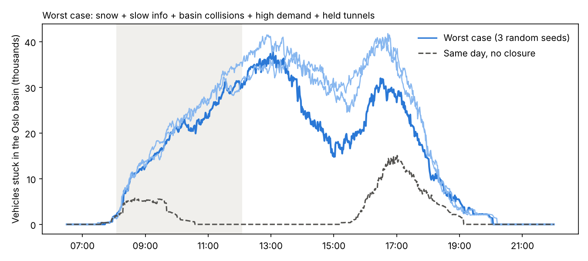
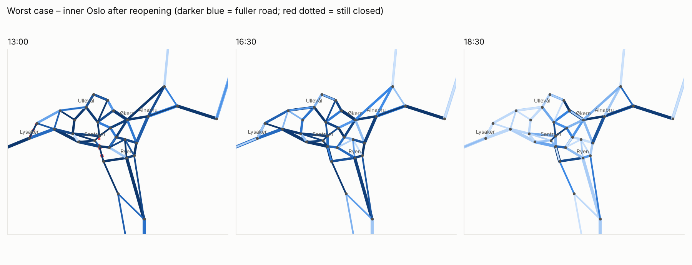

# QA: data basis and worst-case gridlock

*QA date 19.11.2026. This document supersedes the numbers in `REPORT.md` where they differ.*

## 1. Verdict on the data basis

| Question | Answer |
|---|---|
| Was version 1 of the model based on real Oslo traffic data? | **No.** Capacities, zone sizes and demand were planning estimates. Version 1 was compared with 8 published tunnel counts and was off by **−56 % to +101 %** (RMSE ≈ 44 %). |
| Is version 2 based on real data? | **Partly.** The demand matrix is now calibrated to published traffic counts (ÅDT, average vehicles per day) for **8 of the 16 tunnels**. Simulated peak-hour volumes match within **−5 % to +7 %** (RMSE 3.8 %). |
| What is still not real data? | No published count was found for 8 tunnels: Svartdal, Ibsen, Bryn, Smestad, Furuset, Gjelleråsen, Nordby and Bjørnegård. These come only from model routing. Other inputs that remain estimates: hourly demand profile, positions of emergency stations, bus volumes and spare rail capacity. |
| Why not the full official data set? | The environment's network policy blocks Statens vegvesen's sources: `trafikkdata-api.atlas.vegvesen.no` (counts per hour/day), `nvdbapiles.atlas.vegvesen.no` (NVDB road and tunnel data, ÅDT per road section) and `vegvesen.no` (reports). The counts used were found through web search, so some are secondary or old. |

**To make the model fully data-based:** allow the three hosts above under *Network access* in the cloud environment's settings (environment menu → Edit → Allowed domains, see [docs](https://code.claude.com/docs/en/cloud-environments#network-access)). Then the model can:
1. Fetch hourly counts for all count points in Oslo and Akershus for a normal weekday.
2. Calibrate every tunnel and every main road per hour, not just the peak hour.
3. Use NVDB for lanes, lengths and speed limits.

### Calibration against published counts

Peak-hour volumes are compared using **AM peak hour = 9.2 % of ÅDT** (8.5 % peak-hour share × 1.08 weekday factor). This is a typical value for urban main roads in Norway and is an *assumption*. Hourly data from trafikkdata.no should replace it.

| Tunnel | Published ÅDT (year) | Source quality* | Target peak hour, both directions (veh/h) | v1 model (deviation) | v2 calibrated (deviation) | Source |
|---|---|---|---|---|---|---|
| Bjørvikatunnelen (E18) | 100,000 (2023) | B | 9,200 | 6,472 (−30 %)† | 8,697 (−5 %) | [Statens vegvesen](https://www.vegvesen.no/om-oss/presse/aktuelt/2023/01/soker-elektroentreprenor-til-norges-mest-trafikkerte-tunneler/) |
| Festningstunnelen (E18) | 80,000 (2013) | B | 7,360 | 6,173 (−16 %)† | 7,482 (+2 %) | [Statsforvalteren](https://www.statsforvalteren.no/contentassets/18d5fa31e96c422ba60c3af34d920d42/soknad---festningstunnelen.pdf) |
| Ekebergtunnelen | 75,000 (≈2017) | C | 6,900 | 6,449 (−7 %)† | 7,380 (+7 %) | [Teknisk Ukeblad](https://www.tu.no/artikler/ekeberg-og-svartdalstunnelene-forbilledlig-tunnelprosjekt/469251) |
| Lørentunnelen (Ring 3) | 68,240 (2023) | C | 6,278 | 6,881 (+10 %)† | 6,341 (+1 %) | [Wikipedia](https://wikiwand.com/no/articles/L%C3%B8rentunnelen) |
| Tåsentunnelen (Ring 3) | 58,000 (2018) | B | 5,336 | 6,532 (+22 %)† | 5,134 (−4 %) | [Statnett](https://www.statnett.no/globalassets/her-er-vare-prosjekter/region-ost/nettplan-stor-oslo/sogn-ulven/arbeidsfaser-og-konsekvenser-for-3.-part.pdf) |
| Vålerengatunnelen (E6) | 56,000 (2018) | C | 5,152 | 2,252 (−56 %)† | 4,980 (−3 %) | [Teknisk Ukeblad](https://www.tu.no/artikler/na-blir-det-ko-i-oslo-ett-lop-av-valerengatunnelen-stenges-ett-ar/492359) |
| Granfosstunnelen (Rv150) | 28,500 (2024)‡ | A | 2,622 | 5,277 (+101 %)† | 2,687 (+2 %) | [Statens vegvesen, byindeks](https://vegvesen.no/globalassets/fag/trafikk/trafikkdata/byindeks_oslo_2018-2024-12.pdf) |
| Hammersborgtunnelen (Ring 1) | 17,400 (2019) | A | 1,601 | 1,525 (−5 %)† | 1,600 (0 %) | [Statens vegvesen, Ring 1](https://www.vegvesen.no/globalassets/vegprosjekter/utbygging/tunneleroslo/vedlegg/ring-1---supplerende-trafikkanalyse-.pdf) |

\* A = official count from Statens vegvesen; B = official but old or indirect; C = secondary source (press or Wikipedia), which must be verified.
† Version 1 network and demand, before corrections.
‡ The source gives 13,340 + 12,650 light vehicles (under 5.6 m); about 8 % heavy vehicles has been added.

### Errors found and fixed

1. **Wrong road numbers and connection for E6.** Svartdalstunnelen and Vålerengatunnelen carry **E6**, not only Rv190. In v1 the route stopped at Ensjø, so Vålerengatunnelen got far too little traffic (−56 %). Fixed by adding the E6 link Ensjø–Økern.
2. **Tunnel lengths and lane counts.** Bjørvika is about 1.1 km, Ekeberg about 1.6 km, Svartdal about 1.3 km and Vålerenga about 0.8 km. Lørentunnelen has 3 lanes in each direction. Festning and Bjørvika had too little capacity for >100,000 vehicles/day. All of these are corrected.
3. **Granfoss / western Ring 3 was overloaded by +101 %.** Fixed by calibrating the demand matrix (iterative fitting to the counts, `calibrate.py`).
4. **People trapped in tunnels was overestimated.** With correct tunnel lengths, the median is **≈ 4,750** (was ≈ 5,800).

### Known weaknesses that remain

* The normal morning peak matches plausible levels (Asker → Sentrum about 33–35 min, Lørenskog → Lysaker about 70–75 min). Off-peak travel times are **too optimistic** (for example Mortensrud → Skøyen in 13 min) because delay at junctions and traffic lights is not modelled. This mainly affects absolute travel times, not the size of the delay.
* There are only 37 zones and a coarse network. Local streets are represented as one queue per zone.
* The afternoon peak is modelled as the morning trips reversed. It has not been calibrated against real afternoon counts.

### The 10 simulations after calibration (v2)

| Simulation | Extra vehicle-hours v1 | **Extra vehicle-hours v2** | Peak queue (lane-km) | People trapped | Ambulance 12-min, lowest | Fire 10-min, lowest | Back to normal |
|---|---|---|---|---|---|---|---|
| S1 Reference | 61,503 | **64,924** | 105 | 4,745 | 77 % | 75 % | 13:00 |
| S2 Rain | 96,831 | **162,192** | 202 | 5,112 | 71 % | 70 % | after 16:00 |
| S3 Snow / winter | 141,609 | **163,132** | 212 | 5,451 | 62 % | 47 % | after 16:00 |
| S4 Fast information | 26,370 | **29,094** | 68 | 4,691 | 87 % | 81 % | 12:15 |
| S5 Slow information | 122,252 | **126,495** | 223 | 4,610 | 74 % | 68 % | 14:08 |
| S6 Secondary collisions | 79,112 | **85,588** | 134 | 4,740 | 81 % | 75 % | 13:32 |
| S7 Prolonged evacuation | 96,872 | **109,441** | 131 | 4,806 | 77 % | 44 % | 14:27 |
| S8 Active traffic management | 38,453 | **42,678** | 89 | 4,638 | 81 % | 76 % | 12:25 |
| S9 High demand | 81,228 | **103,515** | 156 | 4,807 | 76 % | 74 % | 13:56 |
| S10 Compound worst case | 291,941 | **224,277** | 317 | 5,426 | 65 % | 17 % | after 16:00 |

The conclusions still hold. The calibrated network runs closer to capacity on the main axes, so **it is more sensitive to small capacity losses**. Rain alone now gives about 2.5× the reference delay, against 1.6× in v1. The ranking of the measures (fast information > traffic management > the rest) is unchanged.

---

## 2. Worst case: the longest gridlock in the Oslo basin

**Definition.** "The Oslo basin" means the areas Sentrum, Indre vest/øst/nord, Ytre vest/øst, Søndre and Groruddalen. "Stuck vehicles" means vehicles on roads in these areas that are close to standstill (≥ 85 % of jam density), plus vehicles queuing on local streets that cannot get onto the main roads. The gridlock counts as **resolved** when this number has been back to normal-day level (+300) for 30 minutes in a row. The simulation runs **06:30–22:00** so that the afternoon peak is included.

**Search.** I tested every combination (2 × 2 × 2 × 2 = 16) of these factors, with vehicles held in the tunnels in every case:
* weather: rain or snow
* information: slow, or none at all (the traffic control centre's feed is also down, so navigation apps keep sending traffic towards the tunnels for an hour)
* collisions: on E18, or on the basin's internal relief routes (Strømsveien, Ring 2 at Tøyen, Mosseveien)
* demand: normal or +8 %

The top 3 were then re-run with 3 random seeds each (`worst_case.py`, `worst_case_seeds.py`).

### Result: the worst scenario

> **Snow + slow or fragmented information + collisions on the relief routes inside the basin + high demand (+8 %) + vehicles held in all tunnels until after reopening.**

| Measure (mean of 3 seeds) | Value |
|---|---|
| Gridlock in the basin resolved | **≈ 20:05** (20:01–20:12), i.e. **≈ 8 hours after the tunnels reopen** and about 12 hours after the closure |
| Peak number of stuck vehicles in the basin | **≈ 40,000** (37,700–41,800). The first peak is around 13:00, and a second peak of the same size comes around 16:45 |
| Fully stopped links in the basin at the same time | up to 24–28 |
| Gridlocked link-minutes in the basin | ≈ 3,500 (S1 Reference: about 100) |
| Vehicle-hours stuck in the basin | ≈ 240,000 |
| Total extra vehicle-hours in the region | 340,000–440,000 |
| Trips abandoned on the way | 50,000–72,000 |

**The top 3 are almost equal** (mean resolution 7 h 52 min – 8 h 1 min after reopening). This means:
* **Snow and high demand are the decisive factors.** All 8 snow combinations resolve at 19:29–20:10. All 8 rain combinations resolve at 18:37–19:35.
* **Vehicles held in the tunnels** add 30–60 min of extra closure in every combination.
* Whether the collision happens on E18 or inside the basin, and whether information is slow or absent, changes the result by only ±10–20 min. Once the basin is gridlocked, it is the capacity of the network that limits the outflow, not route choice.

### Why it takes so long (how the scenario unfolds)

1. **08:05–12:05:** The basin fills up steadily, because traffic from E18, E6 and Ring 3 is forced into the city street network and cannot get out on the other side. By 12:00 there are about 35,000 stuck vehicles.
2. **12:05–13:00:** The tunnels reopen, but vehicles abandoned inside them must be cleared first (30–60 min). At the same time, the delayed trips start out. The **first peak** comes at about 13:00.
3. **13:00–15:00:** The queues ease partly, but only down to about 15,000–30,000. In snow, capacity is 20 % lower, so the backlog is emptied slowly.
4. **15:00–17:00:** The **afternoon peak** starts before the morning backlog has cleared. People who drove in during the morning now try to drive home, and a **second peak** of 30,000–42,000 stuck vehicles builds up around 16:30–17:00.
5. **17:00–20:00:** The queues ease gradually. Last to clear are Økern–Sinsen, Ryen–Helsfyr and the Ensjø/Tøyen area. These are the junctions between E6, Ring 2 and Ring 3.

### What breaks the worst case

Based on the earlier sensitivity analysis (S4/S8) and the factor analysis above:
1. **Let vehicles drive out of the tunnels as soon as it is safe**, and plan to clear abandoned vehicles fast. This saves 30–60 min before the network can work again.
2. **Strong information right away, aimed at the afternoon as well**, for example "Do not drive into Oslo today – those who drove in should wait until after 18:00 or leave the car". This dampens the second peak, which is what makes the gridlock last into the evening.
3. **Snow plan + clearing of collisions:** tow trucks pre-positioned on Strømsveien, Ring 2 and Mosseveien, and priority snow clearing on the relief routes.
4. **Metering inflow at the borders of the basin** (E18 Lysaker, E6 Ryen/Alnabru, Rv4 Grorud), so that the basin itself does not lock up.

---

### Files
* `network.py` – network and published counts (`COUNTS`, with sources)
* `calibrate.py` → `calibration.json` – demand-matrix calibration and its history
* `run.py` → `results.json`, `figures/01–07` – the 10 simulations (v2)
* `worst_case.py` → `worst_case_search.json` – factor search
* `worst_case_seeds.py` → `worst_case_seeds.json`, `figures/08–09` – robustness check

Sources (web search 19.11.2026): see the source column in the calibration table, as well as [Ruter on Brynstunnelen](https://ruter.no/en/news/bryn-tunnel-to-close-how-you-can-contribute-to-less-queues) and [Dagbladet on the fire in Ekebergtunnelen](https://www.dagbladet.no/nyheter/tunnelbrann-i-oslo/83346474) for context.
