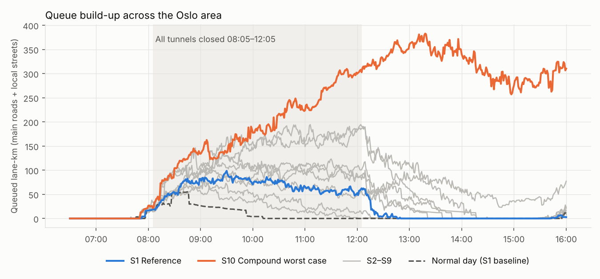
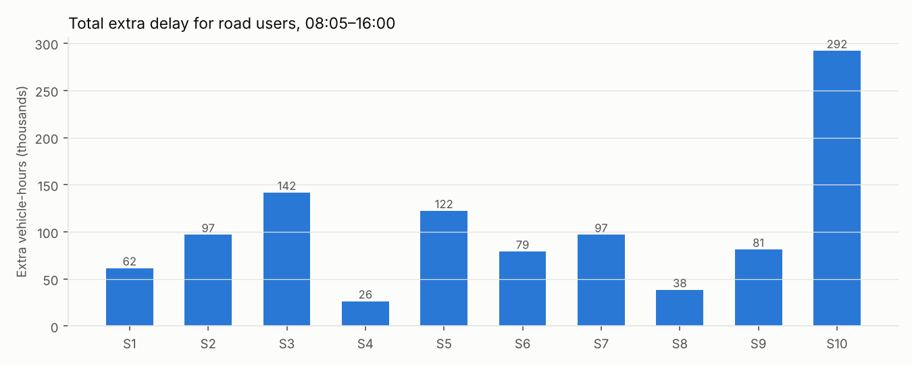
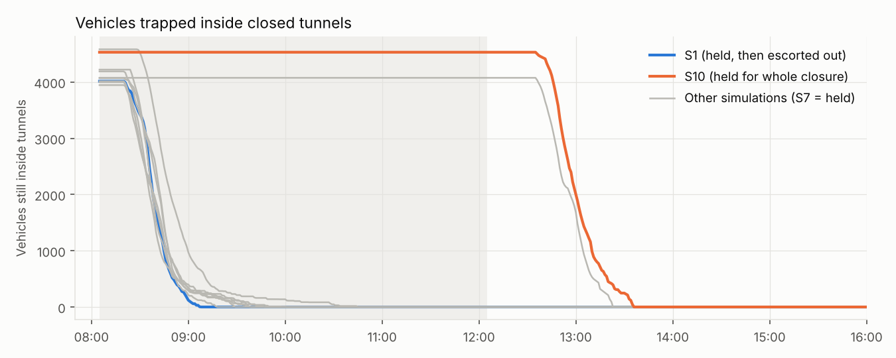
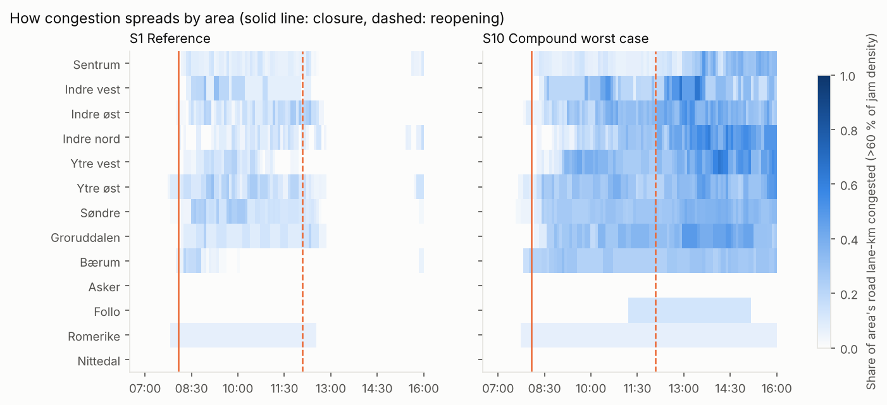
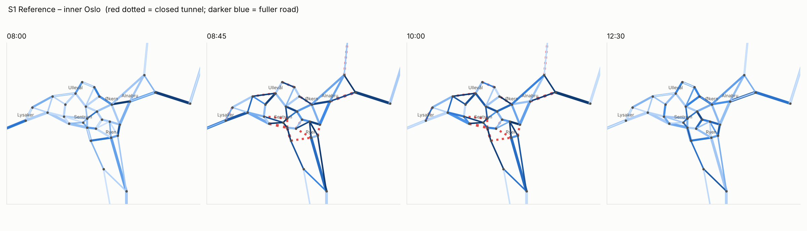
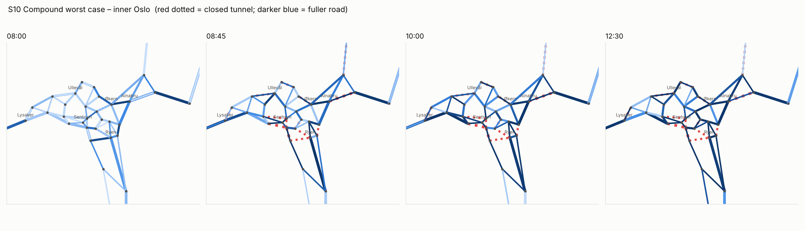
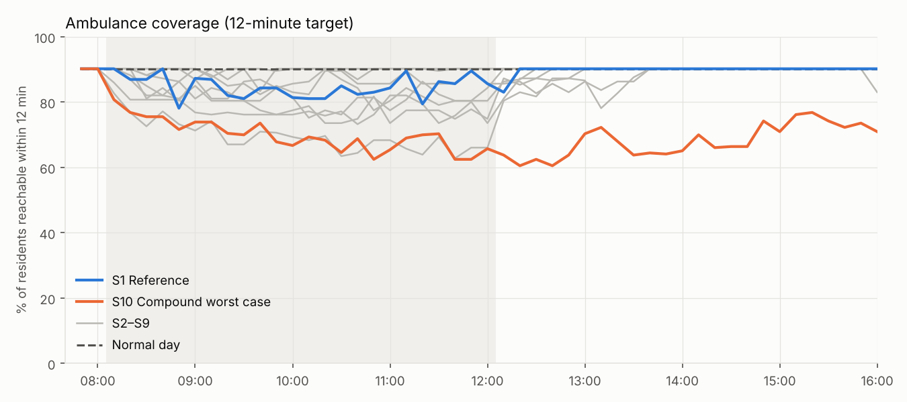

# Unplanned closure of all road tunnels in the Oslo area – 10 simulations

**Scenario:** On an ordinary weekday at **08:05**, every road tunnel in the Oslo metropolitan area closes without warning, with vehicles still inside. All tunnels stay closed for **4 hours, until 12:05**. Each run simulates 06:30–16:00.

**Tunnels included (16):** Festningstunnelen, Bjørvikatunnelen, Ekebergtunnelen, Svartdalstunnelen, Vålerengatunnelen, Ibsentunnelen, Vaterland/Hammersborg (Ring 1), Brynstunnelen, Lørentunnelen, Tåsentunnelen, Smestadtunnelen, Granfosstunnelen, Furusettunnelen, Bjørnegårdtunnelen (E16), Gjelleråstunnelen (Rv4) and Nordbytunnelen (E6).

> ⚠️ **Read this first.** This is a scenario model built on rounded estimates. It does not use NVDB counts, the regional transport model (RTM) or Ruter data. Use it for the size and shape of the impact and to compare the simulations against each other, not as exact figures. See *Limitations* at the end.

---

## 1. Main findings

| | Median of 10 simulations | Range |
|---|---|---|
| People trapped inside tunnels at 08:05 | **≈ 5,800** (≈ 4,100 vehicles, ≈ 25–35 buses) | 5,500 – 6,700 |
| Extra vehicle-hours lost by road users | **≈ 89,000** | 26,000 – 292,000 |
| Socio-economic time cost (300 NOK per vehicle-hour) | **≈ 27 MNOK** | 8 – 88 MNOK |
| Peak queue length (main roads + local streets) | **≈ 115 lane-km** | 67 – 383 |
| Ambulance coverage, share of residents reached within 12 min (normally ≈ 90 %) | **lowest point ≈ 76 %** | 62 – 88 % |
| Back to normal traffic | 12:05 – 14:20 | in 2 of 10 runs, *not before 16:00*, which collides with the afternoon peak |

1. **The ring roads lose their structure.** All three rings (Ring 1, Ring 3 and E18/Operatunnelen) are cut in several places. Traffic is pushed onto Ring 2, Mosseveien, Strømsveien, Drammensveien, Trondheimsveien, Slemdalsveien/Vinderen and local streets. These roads have only 25–40 % of the tunnel capacity.
2. **Congestion starts at the portals and moves outwards.** The first areas to queue up (within 10–30 min) are Søndre (Ryen–Ekeberg), Ytre øst (Bryn–Økern–Alnabru) and Indre vest (Majorstua–Frogner–Skøyen). Groruddalen follows, then Indre nord (Ullevål–Storo). The city centre itself gets relatively little traffic, because fewer cars can reach it.
3. **The worst gridlock forms where several tunnels meet:** Ryen (Ekeberg, Svartdal, Brynstunnelen), Økern–Sinsen (Lørentunnelen) and Alnabru–Furuset (E6). Queues back up from these points onto the E6 from Romerike and Follo and onto the E18 from Bærum.
4. **Information is the biggest lever.** Fast, coordinated information (S4) cuts total delay to **less than half** of the reference run and about **one fifth** of the slow-information run (S5). It works mainly by getting people to stay home or switch to rail/metro *before* they leave.
5. **Emergency preparedness has two weak points.**
   * **Ambulance response times get worse across the area.** Average response goes from ~4.5 to 6–12 min. The worst-hit areas (Furuset/Stovner, Manglerud/Østensjø, Ås/Vestby) see 20–40 min.
   * **Evacuating 16 tunnels at once ties up the fire service.** In S7 and S10, where vehicles are held inside the tunnels, only **20–26 %** of residents are within 10 min of an *available* fire station.
6. **Reopening is not the end.** After 12:05, held vehicles leave the tunnels, delayed trips start again and the afternoon peak begins. With snow or several aggravating factors, the network has not recovered by 16:00.

---

## 2. The 10 simulations

| # | Simulation | What changes |
|---|---|---|
| S1 | Reference | Dry roads, normal demand, normal spread of information. Vehicles held 15–40 min, then escorted out. |
| S2 | Rain | Capacity −8 %, speed −8 %, demand +3 %. |
| S3 | Snow / winter | Capacity −20 %, speed −25 %, emergency vehicles slower, less shift to rail. |
| S4 | Fast coordinated information | Push alerts, VMS signs and radio within 4 min. 92 % of drivers informed. Strong appeal to stay home. |
| S5 | Slow / fragmented information | Apps update after 25 min. Only 55 % of drivers ever informed. |
| S6 | Secondary collisions | Rear-end collision on E18 Skøyen–Filipstad at 08:40 and on Ring 2 at Ullevål at 09:30. |
| S7 | Prolonged tunnel evacuation | Vehicles may not drive out (ventilation/lighting failure). Occupants evacuate on foot. Cars cleared 30–60 min after reopening. |
| S8 | Active traffic management | Police at junctions, emergency signal plans (+12 % arterial capacity), inflow metering on E18/E6/Rv4. |
| S9 | High-demand day | Demand +8 % (school start, an event, or a Monday after a holiday). |
| S10 | Compound worst case | Snow + slow information + collision + vehicles held in tunnels for the whole closure. |

Each simulation also uses its own random seed, which varies demand by ±7 % per origin–destination pair, the hold time per tunnel and route choices. Each run is compared with a **separate baseline**: the same day with the same weather and demand, but no closure.

### Summary by simulation

| Sim | Trapped vehicles / people | Longest time trapped | Peak queue, lane-km (time) | Gridlocked link-minutes | Extra vehicle-hours | Cost (MNOK) | Ambulance 12-min, lowest | Fire 10-min, lowest | Back to normal |
|---|---|---|---|---|---|---|---|---|---|
| S1 Reference | 4,028 / 5,597 | 63 min | 99 (09:30) | 108 | 61,503 | 18 | 78 % (normal 90 %) | 75 % | 12:41 |
| S2 Rain | 4,202 / 5,896 | 94 min | 123 (11:30) | 245 | 96,831 | 29 | 73 % | 74 % | 14:17 |
| S3 Snow / winter | 4,594 / 6,692 | 160 min | 190 (12:07) | 635 | 141,609 | 42 | 63 % | 55 % | after 16:00 |
| S4 Fast information | 4,027 / 5,574 | 93 min | 67 (09:10) | 28 | 26,370 | 8 | 88 % | 79 % | 12:05 |
| S5 Slow information | 4,010 / 5,614 | 84 min | 194 (11:06) | 676 | 122,252 | 37 | 74 % | 69 % | 13:49 |
| S6 Secondary collisions | 3,959 / 5,518 | 102 min | 106 (10:07) | 223 | 79,112 | 24 | 77 % | 75 % | 13:38 |
| S7 Prolonged evacuation | 4,089 / 5,877 | **318 min** | 97 (12:54) | 137 | 96,872 | 29 | 82 % | **26 %** | 14:11 |
| S8 Active traffic mgmt. | 4,082 / 5,743 | 73 min | 78 (09:04) | 62 | 38,453 | 12 | 83 % | 78 % | 12:13 |
| S9 High demand | 4,235 / 5,874 | 116 min | 137 (09:44) | 199 | 81,228 | 24 | 75 % | 74 % | 13:21 |
| S10 Worst case | 4,542 / 6,525 | **331 min** | **383** (13:18) | **2,721** | **291,941** | **88** | **62 %** | **20 %** | after 16:00 |

---

## 3. Vehicles and people inside the tunnels

At 08:05 the morning peak is at its height, so the tunnels are full. Median number of vehicles inside, per tunnel:

| Tunnel | Vehicles | | Tunnel | Vehicles |
|---|---|---|---|---|
| Furusettunnelen (E6) | ~720 | | Bjørnegårdtunnelen (E16) | ~220 |
| Ekebergtunnelen | ~535 | | Bjørvikatunnelen | ~205 |
| Brynstunnelen | ~405 | | Granfosstunnelen | ~185 |
| Lørentunnelen | ~345 | | Gjelleråstunnelen (Rv4) | ~160 |
| Smestadtunnelen | ~330 | | Vaterland/Hammersborg | ~80 |
| Nordbytunnelen (E6) | ~255 | | Ibsentunnelen | ~65 |
| Festningstunnelen | ~230 | | Svartdalstunnelen / Vålerengatunnelen | ~50 each |
| Tåsentunnelen | ~225 | | **Total** | **≈ 4,000–4,600** |

* **If traffic is escorted out** (S1–S6, S8–S9), most tunnels are empty within 25–60 min. The slowest are tunnels whose exits lead straight into the jams they are emptying into (Ekeberg, Furuset, Bjørvika), which take up to 1.5–2.5 hours. The exits are blocked by the congestion that the closure itself has caused.
* **If vehicles must stay put** (S7/S10), ~5,900–6,500 people have to walk out through emergency exits. Their cars stay inside until after reopening. The last vehicles are out only at **13:00–13:40**, and the tunnels cannot take full traffic until then, which delays the recovery by 1–2 hours.
* **Risks to plan for:** people walking out onto the roads, medical emergencies among those trapped, and poor air quality if ventilation has failed. There is also the risk of panic or vehicles reversing inside the tunnels. Each tunnel needs its own team on site (VTS, police, fire service). That is the main reason fire coverage drops so sharply in S7/S10.

---

## 4. Traffic: gridlock and how congestion spreads

**Phase 1 (08:05–08:30): queues at the portals.** Uninformed drivers keep heading for the tunnels, find them closed and turn back at the last junction. This happens just as the morning peak is at its height. Queues at Ryen, Bryn, Økern, Smestad and Filipstad grow by 1–3 km within 20 minutes.

**Phase 2 (08:30–10:00): congestion spreads.** Navigation apps send traffic onto parallel routes, which fill up one after another:
* **West:** E18 → Drammensveien / Frogner / Ring 2 / Sørkedalsveien. Ring 3 at Smestad → Slemdalsveien / Vinderen.
* **East:** Ring 3 at Bryn/Økern → Strømsveien, Østensjøveien, Økernveien, Trondheimsveien.
* **South:** E6/E18 from Follo stops at Ryen. Traffic is pushed onto Mosseveien and local roads at Ljan and Nordstrand, where queues build towards the centre.
* **North:** Rv4 traffic from Nittedal is held back by Gjelleråstunnelen and is left with Gamle Hadelandsvei.

**Phase 3 (10:00–12:05): the queues settle.** In the moderate runs, demand falls (people cancel or switch to rail/metro) and the queues stabilise. With rain or snow, slow information or high demand, they keep growing. Cross-traffic gets stuck at junctions in the "triangles" Ryen–Helsfyr–Bryn and Økern–Sinsen–Tøyen, and gridlock follows (S10: up to 26 links fully stopped at the same time).

**Phase 4 (12:05 onwards): reopening and recovery.** The tunnels first release the vehicles held inside. Then the delayed trips set off, roughly 45 % of the cancelled trips, spread over 12:05–13:45. That gives a second peak around 12:30–13:00. In the good runs, normal traffic returns 0–40 min after reopening. In the poor runs it takes 1.5–2 hours, and in snow / the worst case it continues into the afternoon peak.

| S1 Reference – network at 08:00, 08:45, 10:00, 12:30 |
|---|
|  |
| **S10 Compound worst case** |
|  |

---

## 5. Car travel times (door to door, including time queuing on local streets)

Travel times in minutes for a trip **departing** at the time shown.

| Trip | Normal 08:30 | S1 08:30 | Median of all 08:30 | S10 08:30 | Normal 10:30 | Median of all 10:30 | S10 10:30 |
|---|---|---|---|---|---|---|---|
| Asker → Sentrum | 46 | 79 | 104 | 244 | 22 | 78 | 237 |
| Sandvika → Helsfyr | 46 | 82 | 99 | 276 | 20 | 90 | 267 |
| Nordre Follo → Majorstua | 29 | 125 | 139 | 355 | 25 | 130 | 213 |
| Lørenskog → Lysaker | 91 | 207 | 235 | 443 | 28 | 147 | 322 |
| Nittedal → Sentrum | 18 | 75 | 95 | 168 | 20 | 100 | 190 |
| Mortensrud → Skøyen | 20 | 110 | 123 | 365 | 14 | 107 | 234 |
| Romerike → Filipstad | 54 | 146 | 167 | 389 | 30 | 138 | 289 |
| Tåsen → Ryen | 12 | 25 | 20 | 25 | 12 | 34 | 105 |
| Grorud → Ullevål | 18 | 49 | 60 | 93 | 15 | 71 | 160 |
| Nordstrand → Sentrum | 14 | 95 | 96 | 83 | 10 | 99 | 304 |

* **Cross-town trips (east ↔ west) are hit hardest.** In the moderate runs they take **3–6× as long as normal**. In the worst case they exceed 4–7 hours (some of these trips are still unfinished at 16:00, so the true figure is higher).
* **The south (Follo, Søndre Nordstrand, Nordstrand) is especially exposed.** All the main routes go through Ekeberg / Svartdal / Brynstunnelen, and the alternatives (Mosseveien, Enebakkveien) have little capacity.
* **Short trips inside the city are hit less**, but still take 1.5–3× as long when they cross a congested corridor.

---

## 6. Public transport

**Buses** (corridor travel times in minutes, not exact Ruter lines):

| Bus corridor | Normal 08:30 | Median S1–S9 08:30 | Median S1–S9 10:30 | S10 10:30 | Diverted around a tunnel? |
|---|---|---|---|---|---|
| Asker/Bærum – Oslo bussterminal (E18) | 49 | 93 | 89 | >240 | yes |
| Follo – Oslo (E6/E18 via Ekeberg) | 25 | 133 | 135 | >240 | yes |
| Romerike – Oslo (E6) | 62 | 152 | 110 | >240 | no (queues) |
| Airport express coach, Gardermoen – Oslo | 68 | 140 | 128 | >240 | no (queues) |
| Nittedal – Oslo (Rv4) | 18 | 53 | 58 | 112 | no |
| Ring 3 cross-town bus (Lysaker–Helsfyr) | 18 | 46 | 43 | >240 | no |
| Inner city east–west (surface) | 11 | 15 | 20 | 225 | no |
| Søndre – Sentrum (Mosseveien) | 17 | 37 | 57 | 145 | no |

* **Regional express buses into the bus terminal lose their route** through Festningstunnelen / Operatunnelen and are caught in the same queues as cars. In the median run their travel time is 2–5× normal. In practice they will **turn at Lysaker, Skøyen, Ryen, Helsfyr or Kolbotn and let passengers transfer to rail or metro**. This should be part of the plan in advance.
* **Bus lanes help.** Buses on urban streets with their own lanes lose noticeably less time than cars. Buses on motorways and ring roads without bus lanes lose as much time as cars.
* **About 25–35 buses with an estimated 1,000–1,400 passengers** are inside the tunnels when they close.
* **Trams:** Lines that run on their own track (e.g. the Ekeberg line) are hardly affected. Lines that share the street with cars in the west (Skøyen/Frogner–Sentrum, Majorstua–Sentrum) get 1.5–2.5× longer travel times. In the worst case this rises to 5–8×.
* **Metro and trains are not directly affected**, but they take on the extra passengers. Between **4,000 and 16,000 people** switch to rail during the closure, with a peak of **1,200–4,200 extra passengers per hour**. On top of that come passengers from cancelled and turned-back buses. The pressure is greatest at Lysaker, Skøyen, Helsfyr, Ryen and Ski/Kolbotn, and at transfer points from buses. Extra trains and metro departures and crowd management at stations are needed.

---

## 7. Emergency services

| | Normal day | S1 | Median | S10 |
|---|---|---|---|---|
| Residents within 12 min of an ambulance (lowest point during the closure) | ~90 % | 78 % | 76 % | 62 % |
| Average ambulance response time (worst moment) | ~4.5 min | 6.4 min | ~7 min | 12 min |
| Residents within 10 min of an *available* fire station | ~90 % | 75 % | 74 % | **20 %** |
| Average time to nearest hospital at 09:30 | 4–7 min | 11 min | ~12 min | 20 min |

* **Ambulances:** Response times get worse everywhere, but most in the east and south: Furuset/Stovner (up to 19–39 min), Manglerud/Østensjø (20–24 min) and Sydhavna (13–15 min). These areas depend on Ring 3 / E6 through Brynstunnelen and Furusettunnelen. The model assumes emergency vehicles **cannot** drive through the closed tunnels. If it is safe to do so (when the closure is caused by a technical fault and not a fire), letting emergency vehicles through the empty tunnels would be one of the most effective measures available.
* **Hospital access:** The worst-affected area is Follo south (Ås/Vestby), with 45–110 min to the nearest hospital because the Nordbytunnelen (E6) is closed. In the city, Ahus is hard to reach from the west and Ullevål / Rikshospitalet are hard to reach from the south and east.
* **Fire and rescue:** When traffic can be escorted out, the evacuation ties up resources for only 30–60 min. When **people must walk out of 16 tunnels at the same time** (S7/S10), the nearest station to almost every tunnel is busy for 1–2 hours. Fire coverage then collapses to 20–26 %. A real fire elsewhere at the same time would be critical. Mutual assistance from neighbouring districts (Asker og Bærum brann og redning, Øvre/Nedre Romerike, Follo) must be called in early.
* **More calls:** Jams lead to more rear-end collisions (see S6) and medical emergencies in queues and tunnels. Each collision on a diversion route costs a further 25–50 % in delay.

---

## 8. What reduces the impact most (based on the simulations)

| Measure | Effect in the model |
|---|---|
| **Fast, coordinated information** (push alerts, VMS signs, NRK/radio, Ruter, employers): "Stay home or work remotely, use rail/metro" | Total delay **−57 %** compared with S1 (−78 % compared with S5). Queues almost gone by 12:05. |
| **Active traffic management** (police at junctions, emergency signal plans, inflow metering at entry points into Oslo) | Delay **−37 %**. Much less gridlock (62 vs. 108 gridlocked link-minutes). |
| **Let vehicles drive out of the tunnels when it is safe**, rather than evacuating on foot | Avoids 1–2 hours of extra recovery time and frees the fire service. |
| **Emergency vehicles allowed through the closed tunnels / their own lanes** | Not modelled, but the closed tunnels are the main reason response times rise. |
| **Pre-planned bus turnaround points + more rail/metro capacity** | Prevents buses from adding to the gridlock and gets passengers moving. |
| **Controlled reopening** (one tunnel at a time, starting with the outbound direction / the E6–E18 axis) | Reduces the second peak after 12:05. |

**Factors that make things worse:** snow (+130 % delay), slow information (+99 %), high demand (+32 %) and secondary collisions (+29 %). When several occur together, the effects multiply rather than add up (S10: +375 %).

---

## 9. Method (short)

* **Model:** a mesoscopic, dynamic network model (`sim.py`) with 1-minute time steps. It represents a simplified road network for Greater Oslo: 37 nodes and 150 directed links, including the 16 tunnels. Each road is a queue with a capacity, a free-flow time and a limited storage space (130 vehicles per km per lane). When a road is full, upstream roads cannot empty, so queues spill backwards and gridlock can form.
* **Demand:** a gravity model built from residents and jobs per zone, with car shares and freight. The morning peak runs home → work, and the afternoon peak builds from 14:00. The baseline is calibrated to plausible peak flows (e.g. 2,500–4,200 vehicles/h per direction in the Operatunnelen system).
* **Behaviour:** drivers who have the information choose routes dynamically from current travel times. Drivers without it follow their usual route until they meet a closed portal. Informed travellers who have not left yet may cancel or postpone the trip, or switch to rail/metro. Travellers who wait more than 40 min to get onto the main road gradually give up.
* **Emergency services:** response times are computed every 10 min from ambulance and fire stations (positions approximate). Blue-light speed depends on how full each road is, with extra delay on clogged local streets. Fire stations serving tunnel evacuations are counted as unavailable.
* **Public transport:** travel times along corridors, computed from the simulated road travel times. Buses get a 40 % reduction in queue delay on urban streets because of bus lanes. Trams share the street with cars on only part of their route.

## 10. Limitations

* The network is **strongly simplified**: local streets are represented only as a "local street queue" and a few surface links. Capacities, zone sizes and the positions of emergency stations are **rounded estimates**. The tunnel list may not be complete (for example, smaller tunnels in Asker/Bærum are left out).
* Delay is measured against a baseline for trips departing in the same 15-minute period. Trips not finished by 16:00 are counted up to 16:00, so the figures for later departures in S3/S10 are **underestimated**.
* Very long bus times in S10 (">240") come from a model running close to complete standstill and should be read as "the line cannot run in practice".
* The real-world behaviour of drivers, emergency services and Ruter in such a situation is uncertain. The ten simulations are meant to cover that uncertainty, not to predict a single outcome.
* For decision-making, the next step should be to calibrate against NVDB counts and travel times, and preferably to run the scenario in Statens vegvesen's / Oslo kommune's own traffic models (e.g. RTM/DOM, Aimsun/Visum).

**Reproduce:** `pip install numpy matplotlib && python3 run.py` (about 2 min). This produces `results.json` and `figures/`.
